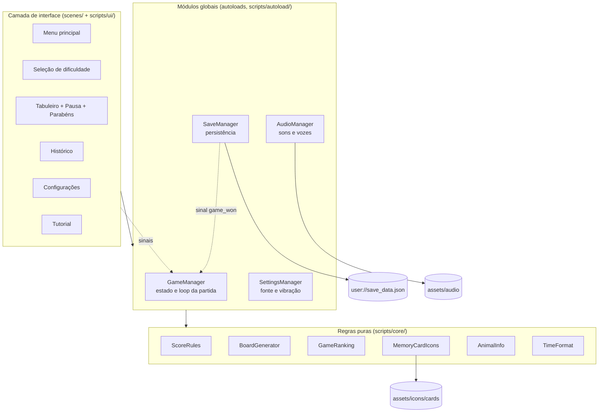
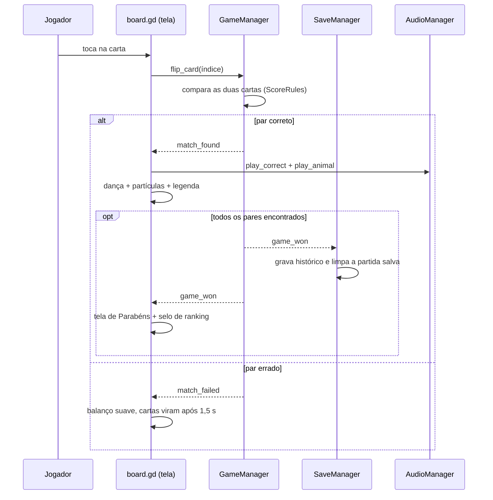
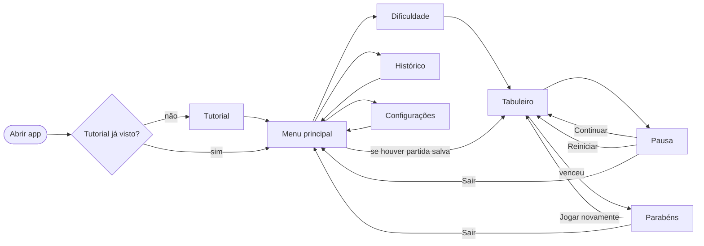

# Arquitetura do Software — Cuca Ativa

**Versão:** 1.0 · **Motor:** Godot 4.7 (GL Compatibility) · **Linguagem:** GDScript · **Plataforma:** Android 8.0+ (API 26)

## 1. Visão geral

O Cuca Ativa é um aplicativo único (sem servidor, sem rede) organizado em três camadas.
A regra central da arquitetura é manter as **regras do jogo separadas das telas**, para que
possam ser testadas sem abrir a interface.



## 2. Camadas e responsabilidades

### 2.1 Regras puras — `scripts/core/`
Classes sem dependência de cena nem do editor (`RefCounted`, métodos `static`). São a base dos
testes automatizados.

| Classe | Responsabilidade | Regras |
|---|---|---|
| `ScoreRules` | Pontos por acerto (com combo), penalidade por erro, piso em 0, condição de vitória | RN01, RN02, RN03 |
| `BoardGenerator` | Gera e embaralha o tabuleiro (8, 15 ou 20 pares conforme o nível) | RF01 |
| `GameRanking` | Posição da partida no ranking do nível e textos do selo | — |
| `MemoryCardIcons` | Lista de fotos por nível e sorteio dos animais de cada partida | RF01, RF02 |
| `AnimalInfo` | Nome e descrição do som de cada animal (legenda) | — |
| `TimeFormat` | Formata segundos como MM:SS | — |

### 2.2 Módulos globais (autoloads) — `scripts/autoload/`
Carregados automaticamente pelo Godot e acessíveis de qualquer tela.

| Autoload | Responsabilidade | Principais elementos |
|---|---|---|
| `GameManager` | Estado e fluxo da partida: virar cartas, pontuar, dicas, cronômetro, vitória, restauração do estado salvo | Sinais `score_changed`, `match_found`, `match_failed`, `game_won`, `hint_used` |
| `SaveManager` | Persistência em JSON: histórico, partida em andamento (autosave), tutorial visto | `add_history_entry`, `autosave_in_progress`, `resume_in_progress` |
| `AudioManager` | Tons de acerto e erro, nome falado do animal, som do animal, volume geral | `play_correct`, `play_incorrect`, `play_animal`, `set_master_volume` |
| `SettingsManager` | Escala do tamanho da letra em todas as telas e vibração | `set_font_scale`, `set_vibration_enabled`, `vibrate_*` |

### 2.3 Interface — `scenes/` e `scripts/ui/`
Cada tela é uma cena (`.tscn`) com um script próprio. As telas **não contêm regras de negócio**:
chamam o `GameManager` e reagem aos sinais dele.

| Cena | Script | Função |
|---|---|---|
| `main_menu/main_menu.tscn` | `main_menu.gd` | Entrada: Jogar, Continuar partida, Histórico, Configurações |
| `game/difficulty_select.tscn` | `difficulty_select.gd` | Escolha do nível |
| `game/board.tscn` | `board.gd` | Tabuleiro, Dica, Pausa e tela de Parabéns |
| `game/history.tscn` | `history.gd` | Lista de partidas vencidas e lugar no ranking |
| `game/settings.tscn` | `settings.gd` | Volume, tamanho da letra e vibração |
| `game/tutorial.tscn` | `tutorial.gd` | Mini jogo 2×2 no primeiro acesso |

O tema visual compartilhado (cores, fontes, botões) fica em `assets/theme/base_theme.tres`.

## 3. Comunicação entre módulos

Os módulos conversam por **sinais** (padrão observador), o que evita que as regras dependam
da interface:



## 4. Fluxo de navegação



## 5. Decisões de projeto

| Decisão | Motivo |
|---|---|
| Regras em `scripts/core/` sem dependência de cena | Permite testes automatizados rápidos e isolados das telas |
| Comunicação por sinais | Telas reagem ao estado sem que o `GameManager` conheça a interface |
| Persistência em JSON local | Simples, legível, 100% offline e sem dados pessoais (RNF07, RNF09) |
| Autosave ao pausar, perder o foco ou fechar | Recuperar a partida após chamada ou fechamento inesperado (RF08) |
| Nome falado + som + legenda a cada acerto | Redundância de canais para quem ouve mal ou vê mal (RNF04 e acessibilidade) |
| Vozes sintetizadas offline (Piper) para animais sem gravação | Todos os 52 animais têm som e nome falado, sem internet e com licença livre |
| Tamanho da letra por escala aplicada ao tema | Um único ajuste vale para todas as telas (RNF02) |
| GL Compatibility | Maior compatibilidade com aparelhos Android mais antigos |

## 6. Estrutura de pastas

```
cuca-ativa/
├── _DocumentaçãoDoProjeto/   documentação (este diretório)
├── scenes/                   telas (.tscn)
├── scripts/
│   ├── autoload/             GameManager, SaveManager, AudioManager, SettingsManager
│   ├── core/                 regras puras
│   └── ui/                   scripts das telas
├── assets/
│   ├── icons/cards/          fotos dos animais (facil/, medio/, dificil/) e verso.svg
│   ├── audio/animals/        sons dos animais, nomes falados e CREDITOS.md
│   └── theme/                tema visual compartilhado
├── tests/                    suítes de teste automatizado
└── docs/                     documentos de trabalho do desenvolvimento
```

## 7. Limitações conhecidas da arquitetura
- As configurações (volume, tamanho da letra, vibração) **não são gravadas em disco**; voltam ao
  padrão ao reabrir o app (problema P05 da avaliação heurística).
- Não há camada de rede: o projeto não faz sincronização nem coleta de dados.
