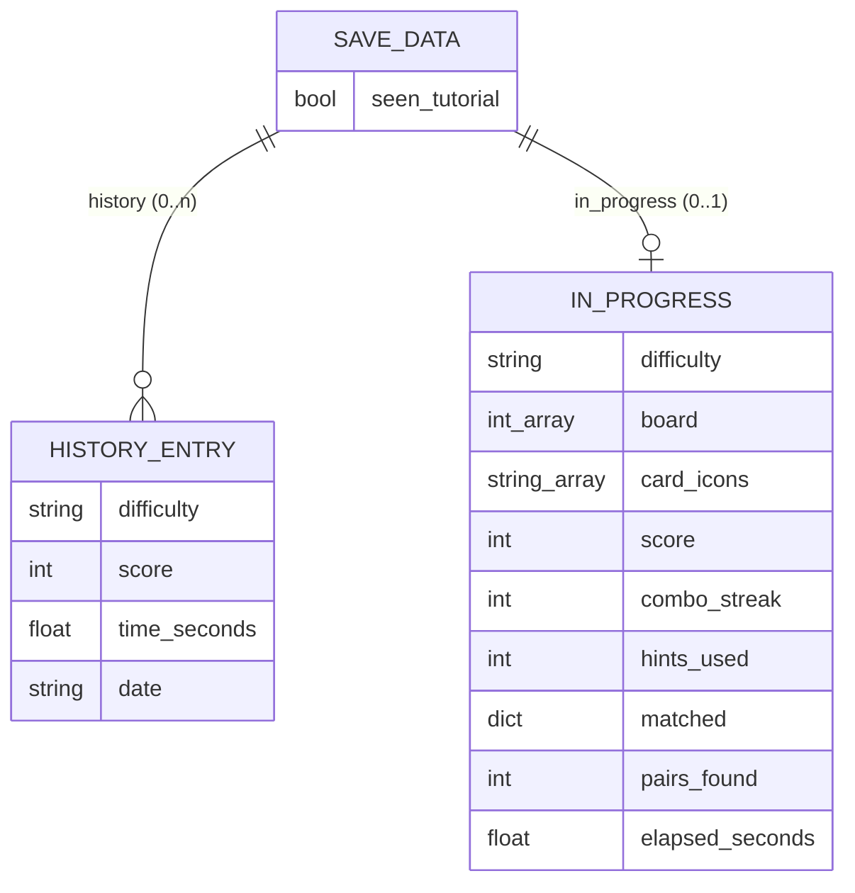

# Modelagem de Dados — Cuca Ativa

O aplicativo não usa banco de dados. Os dados persistentes ficam em **um único arquivo JSON**
no armazenamento privado do aplicativo (`user://save_data.json`), gerenciado pelo `SaveManager`.
Os demais dados (animais, estado da partida, configurações) são constantes do código ou
ficam apenas em memória.

## 1. Visão geral



## 2. Arquivo de salvamento (`user://save_data.json`)

Escrito sempre por inteiro, a cada alteração. Se o arquivo não existe ou está corrompido, o jogo
começa com estado vazio (caso normal na primeira execução).

```json
{
  "seen_tutorial": true,
  "history": [
    { "difficulty": "facil", "score": 80, "time_seconds": 95.4, "date": "2026-11-24T14:03:10" }
  ],
  "in_progress": {
    "difficulty": "medio",
    "board": [3, 7, 0, 3, 1, 7],
    "card_icons": ["res://assets/icons/cards/medio/coala.jpg"],
    "score": 45,
    "combo_streak": 2,
    "hints_used": 1,
    "matched": { "0": true, "2": true },
    "pairs_found": 1,
    "elapsed_seconds": 62.8
  }
}
```

### 2.1 `history` — histórico de partidas vencidas
Uma entrada por vitória (RN05). Partidas abandonadas, reiniciadas ou pausadas **não** geram registro.

| Campo | Tipo | Descrição |
|---|---|---|
| `difficulty` | texto | `"facil"`, `"medio"` ou `"dificil"` |
| `score` | inteiro | Pontuação final da partida |
| `time_seconds` | decimal | Tempo total da partida, em segundos |
| `date` | texto | Data e hora do dispositivo no momento da vitória |

O ranking e a coluna "LUGAR" do histórico **não são gravados**: são calculados na hora, a partir
destas entradas (mais pontos primeiro; empate decidido pelo menor tempo; só entre partidas do
mesmo nível).

### 2.2 `in_progress` — partida em andamento (autosave, RF08)
Existe no máximo uma. É gravada ao pausar, perder o foco ou fechar o app, e apagada ao vencer.

| Campo | Tipo | Descrição |
|---|---|---|
| `difficulty` | texto | Nível da partida |
| `board` | lista de inteiros | Id do par de cada posição, na ordem embaralhada (cada id aparece 2×) |
| `card_icons` | lista de textos | Caminho da foto de cada par (índice = id do par), para retomar com as mesmas figuras |
| `score` | inteiro | Pontuação atual (mínimo 0) |
| `combo_streak` | inteiro | Acertos consecutivos sem erro |
| `hints_used` | inteiro | Dicas já usadas (máximo 3) |
| `matched` | mapa | Posições já resolvidas (`"posição": true`) |
| `pairs_found` | inteiro | Pares já encontrados |
| `elapsed_seconds` | decimal | Cronômetro progressivo |

### 2.3 `seen_tutorial`
Booleano. Indica que o tutorial já foi mostrado nesta instalação (RF05).

## 3. Dados fixos no código

| Dado | Onde | Conteúdo |
|---|---|---|
| Pares por nível | `BoardGenerator.PAIRS_PER_DIFFICULTY` | Fácil 8 · Médio 15 · Difícil 20 (16 / 30 / 40 cartas) |
| Pontuação | `ScoreRules` | +10 por acerto, +5 de bônus acumulado por acerto seguido, −2 por erro, piso em 0 |
| Dicas | `GameManager` | Custo 15 pontos, máximo 3 por partida |
| Animais por nível | `MemoryCardIcons` | 12 no Fácil, 20 no Médio, 20 no Difícil (52 no total) |
| Nome e som de cada animal | `AnimalInfo` | `{ "chave": ["Nome", "descrição do som"] }` |

## 4. Arquivos de mídia

| Tipo | Local | Formato |
|---|---|---|
| Fotos dos animais | `assets/icons/cards/{facil,medio,dificil}/` | JPG 512×512 |
| Verso da carta | `assets/icons/cards/verso.svg` | SVG |
| Sons dos animais | `assets/audio/animals/` | WAV/OGG/MP3 (trecho de até 3 s) |
| Nomes falados | `assets/audio/animals/nomes/` | Voz sintetizada (Piper, pt_BR, CC0) |
| Créditos e licenças | `assets/audio/animals/CREDITOS.md` | Texto |

Cada animal é ligado aos seus arquivos pelo **nome-chave** (por exemplo `leao_marinho`), o mesmo
nome da foto, do som e da entrada em `AnimalInfo`.

## 5. Dados em memória (não persistidos)

| Dado | Onde | Observação |
|---|---|---|
| Escala da letra (1,0 / 1,25 / 1,5) | `SettingsManager.font_scale` | Volta ao padrão ao reabrir o app |
| Vibração ligada/desligada | `SettingsManager.vibration_enabled` | Idem |
| Volume geral | `AudioManager` | Idem |
| Estado vivo da partida | `GameManager` | Copiado para `in_progress` no autosave |

## 6. Privacidade (LGPD — RNF09)
O arquivo guarda apenas pontuação, tempo, data e o estado do jogo. **Não há nome, e-mail,
identificador do aparelho nem qualquer dado pessoal**, e nada é enviado pela rede. O arquivo fica
no armazenamento privado do aplicativo e é removido ao desinstalar.
