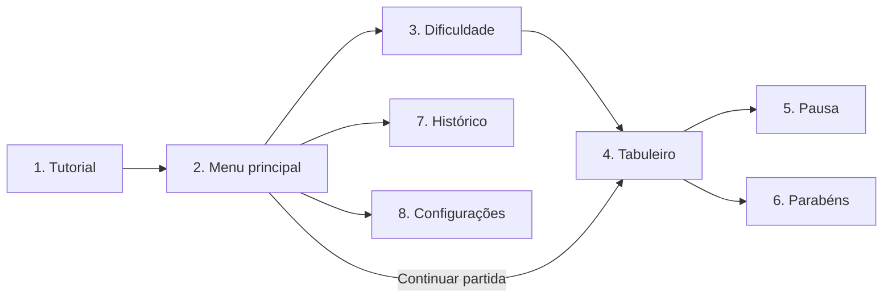

# Storyboard das Telas — Cuca Ativa

Descrição das 6 telas do aplicativo (mais a pausa e a tela de Parabéns, que ficam sobre o
tabuleiro), com esquema de layout, elementos, ações e destino de cada botão. Tela de referência:
412 × 917 px, em retrato, ajustada automaticamente a outros tamanhos (RNF06).

Princípios aplicados em todas as telas: botões grandes (≥ 48 × 48 dp, RNF03), contraste mínimo de
4,5:1 (RNF01), fonte sem serifa com texto ≥ 18 sp (RNF02) e nenhum elemento punitivo (RNF04).

## Mapa de navegação



---

## 1. Tutorial (primeiro acesso)
Aparece **uma única vez**, antes do menu (RF05).

```
┌──────────────────────────┐
│        Tutorial          │
│ ┌──────────────────────┐ │
│ │ Toque em 2 cartas    │ │
│ │ para encontrar o par │ │
│ │ correto!             │ │
│ └──────────────────────┘ │
│     ┌─────┐  ┌─────┐     │
│     │ 🐾  │  │ 🐾  │     │
│     └─────┘  └─────┘     │
│     ┌─────┐  ┌─────┐     │
│     │ 🐾  │  │ 🐾  │     │
│     └─────┘  └─────┘     │
│                          │
│     [    Entendi!    ]   │
└──────────────────────────┘
```

| Elemento | Comportamento |
|---|---|
| Quadro de instrução | Explica o objetivo; ao concluir o exercício, passa a dizer "Muito bem! Agora toque em Entendi!" |
| 4 cartas (2×2) | Mini jogo com 2 pares de animais reais e o mesmo verso do jogo; sem pontuação |
| Botão "Entendi!" | Balança suavemente ao fim do exercício. Marca o tutorial como visto e vai ao **Menu principal** |

## 2. Menu principal

```
┌──────────────────────────┐
│     Jogo da Memória      │
│        Cuca Ativa        │
│                          │
│     [      JOGAR     ]   │
│  [ Continuar partida ]   │  ← só aparece se houver partida salva
│                          │
│   (Histórico) (Config.)  │
└──────────────────────────┘
```

| Botão | Ação |
|---|---|
| Jogar | Vai à **Dificuldade** |
| Continuar partida | Retoma a partida salva no **Tabuleiro** (RF08). Oculto quando não há partida |
| Histórico | Vai ao **Histórico** |
| Configurações | Vai às **Configurações** |

## 3. Seleção de dificuldade

```
┌──────────────────────────┐
│       Dificuldade        │
│                          │
│     [     Fácil      ]   │   16 cartas
│     [     Médio      ]   │   30 cartas
│     [    Difícil     ]   │   40 cartas
│                          │
│     [    VOLTAR      ]   │
└──────────────────────────┘
```

Cada nível inicia uma partida nova no **Tabuleiro** (RF01). Voltar retorna ao **Menu**.

## 4. Tabuleiro

```
┌──────────────────────────┐
│  Pontuação        45     │
│ ┌──────────────────────┐ │
│ │ Leão — Ruge: Rrroarr!│ │  ← legenda amarela do último acerto
│ └──────────────────────┘ │
│  ┌──┐ ┌──┐ ┌──┐ ┌──┐     │
│  │🐾│ │🐾│ │🦁│ │🐾│     │
│  └──┘ └──┘ └──┘ └──┘     │   Fácil: 4 colunas
│  ┌──┐ ┌──┐ ┌──┐ ┌──┐     │   Médio e Difícil: 5 colunas
│  │🐾│ │🐾│ │🐾│ │🐾│     │   (todas as cartas cabem na tela,
│  └──┘ └──┘ └──┘ └──┘     │    sem rolagem)
│   ...                    │
│  (★ 3 DICA)     (Pausa)  │
└──────────────────────────┘
```

| Elemento | Comportamento |
|---|---|
| Pontuação | Atualizada a cada jogada (+10, bônus de combo, −2 por erro, nunca abaixo de 0) |
| Cartas | Tocar vira a carta; duas viradas são comparadas |
| Acerto (RF03) | Tom de acerto, vibração, as cartas "dançam" com partículas douradas, o nome do animal é falado, depois o som dele, com a legenda amarela na tela |
| Erro (RF03) | Tom suave, vibração leve, balanço suave (sem vermelho); as cartas voltam a ficar viradas após **1,5 s** |
| Dica (RF13) | Estrela com o número de dicas restantes (3 no início). Custa 15 pontos e destaca um par com moldura amarela pulsante, sem revelar o animal. Fica esmaecida se não puder ser usada |
| Pausa | Abre a **Pausa** e congela o cronômetro |

O cronômetro é interno e **progressivo** (nunca regressivo); aparece só no resultado final.

## 5. Pausa (sobre o tabuleiro)

```
┌──────────────────────────┐
│          Pausa           │
│                          │
│     [   Continuar   ]    │
│     [   Reiniciar   ]    │
│     [     Sair      ]    │
└──────────────────────────┘
```

| Botão | Ação |
|---|---|
| Continuar | Fecha a pausa e retoma a partida |
| Reiniciar | Zera pontuação, tempo e progresso e reembaralha o mesmo nível (RN06) |
| Sair | Guarda a partida (poderá ser retomada) e volta ao **Menu** |

## 6. Parabéns (ao encontrar todos os pares)
Aparece cerca de 3,2 s após o último acerto, para dar tempo de ouvir o nome e o som do animal.

```
┌──────────────────────────┐
│        Parabéns!         │
│    Pontuação: 120        │
│    Tempo: 01:35          │
│  ┌────────────────────┐  │
│  │    1º LUGAR        │  │  ← selo amarelo
│  │ Novo recorde no    │  │
│  │ Fácil!             │  │
│  └────────────────────┘  │
│        (arara)           │
│  [ Jogar novamente ]     │
│  [      Sair       ]     │
└──────────────────────────┘
```

| Elemento | Comportamento |
|---|---|
| Pontuação e tempo | Resultado final da partida, que também vai para o histórico (RN05) |
| Selo de colocação | Posição no ranking do **mesmo nível** (mais pontos; empate pelo menor tempo). Texto sempre positivo |
| Jogar novamente | Nova partida no mesmo nível |
| Sair | Volta ao **Menu** |

## 7. Histórico

```
┌──────────────────────────┐
│        Histórico         │
│ ┌──────────────────────┐ │
│ │ PONTOS  TEMPO  LUGAR │ │
│ │ ──────────────────── │ │
│ │  120    01:35    1º  │ │
│ │                 Fácil│ │
│ │   85    03:10    2º  │ │
│ │                Médio │ │
│ └──────────────────────┘ │
│     [    VOLTAR      ]   │
└──────────────────────────┘
```

Lista as partidas vencidas, da mais recente para a mais antiga (RF07). Cada linha mostra os pontos, o
tempo e o lugar da partida no ranking do seu nível, com o nome do nível abaixo do lugar. Sem partidas, mostra:
"Nenhuma partida vencida ainda. Jogue e vença para aparecer aqui!".

## 8. Configurações

```
┌──────────────────────────┐
│      Configurações       │
│  Volume do jogo          │
│   (🔊)  ( ) Desligado    │
│         (✓) Médio        │
│         ( ) Alto         │
│  Tamanho da letra        │
│   (Aa)  (✓) Padrão       │
│         ( ) Grande       │
│         ( ) Muito Grande │
│  Vibração                │
│   (📳)  (✓) Ligada       │
│         ( ) Desligada    │
│     [    VOLTAR      ]   │
└──────────────────────────┘
```

| Opção | Efeito |
|---|---|
| Volume | Desligado / Médio / Alto. Vale para tons, nomes e sons |
| Tamanho da letra | Padrão (100%), Grande (125%) e Muito Grande (150%). Vale em todas as telas; títulos decorativos não crescem |
| Vibração | Interruptor próprio, independente do volume. Ao ligar, dá um pulso de exemplo |

> As configurações valem durante o uso do aplicativo, mas ainda não são gravadas ao fechá-lo
> (melhoria futura).

---

## Observação sobre as imagens
Os esquemas acima são wireframes de texto. As capturas reais das telas, tiradas do aplicativo no
celular, estão na apresentação (`ApresentaçãoProjetoCucaAtiva`) e no vídeo
`Video-JogoCucaAtiva.mp4`.
